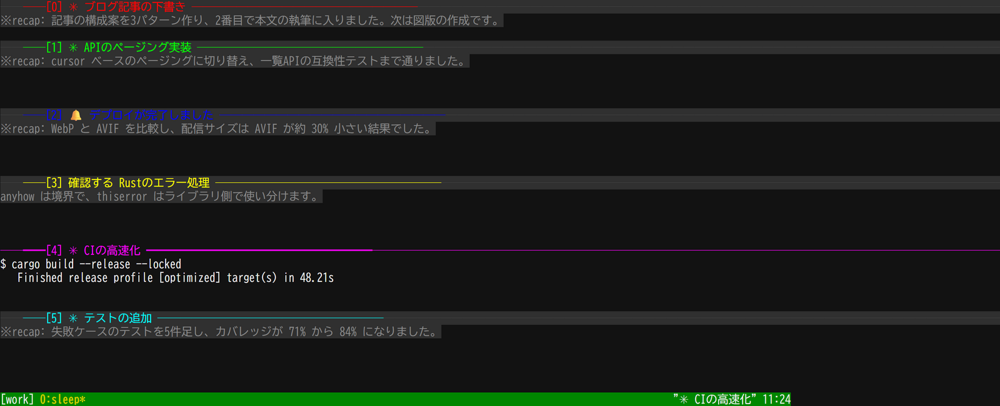

# tmux-pane-beacon

[](https://github.com/ryuchan00/tmux-pane-beacon/actions/workflows/ci.yml)
[](https://github.com/ryuchan00/tmux-pane-beacon/releases/latest)

[English](README.md) | 日本語

tmux のペインごとに色を付け、上側の枠にペイン番号と端末タイトルを表示するプラグインです。複数のターミナルやコーディングエージェントを並べたときに、目的のペインを見分けられます。

- ペインを識別する色は、レイアウトを変えても維持されます。
- アプリが設定した端末タイトルを枠に表示します。
- エージェントの hook を設定すると、実行中・入力待ちの記号や完了通知も表示できます。



[導入](#導入) · [状態表示と通知](#エージェントの実行状態と通知) · [設定一覧](#オプション) · [困ったとき](#困ったとき)

## 要件

- tmux 3.0 以降 (ペイン単位オプション `set-option -p` と hook の配列指定を使うため)
- bash と、curl または wget (TPM の入口とバイナリの取得に使う)
- Rust 1.85 以降 (リリースを使わず自分でビルドする場合のみ)

CI では macOS (Intel と Apple Silicon)、Ubuntu、Debian bookworm と trixie (リリースと同じ静的リンク版) でテストを実行しています。日常の利用では tmux 3.7b (macOS) と tmux 3.2a (Ubuntu on WSL) で動かしています。

## 導入

[TPM](https://github.com/tmux-plugins/tpm) を導入済みの環境で、`~/.tmux.conf` の TPM 実行行より前にプラグインを追加します。

```tmux
set -g @plugin 'ryuchan00/tmux-pane-beacon'

# 既存の TPM 実行行を末尾に置く
run '~/.tmux/plugins/tpm/tpm'
```

設定を保存し、tmux 内で次を実行してから `prefix + I`（大文字の I）を押します。`prefix` は tmux の操作開始キーで、既定では `Ctrl+b` です。

```bash
tmux source-file ~/.tmux.conf
```

初回読み込み時に、実行中のプラットフォーム向けのビルド済みバイナリを対応するGitHubリリースから取得し、公開されている `SHA256SUMS` と突き合わせたうえで、プラグインディレクトリの `bin/pane-beacon` に置きます。リリースは Intel/Arm の Linux と macOS を対象にしています。

### 表示を確認する

tmux 内でペインを分割すると、各ペインの上側に色付きの番号とタイトルが表示されます。タイトルの表示だけを試すには、シェルで次を実行します。

```bash
printf '\033]2;beacon demo\007'
```

シェルやアプリが次のタイトルを送ると、その内容に置き換わります。

### ソースからビルドする

ビルド済みバイナリが無いプラットフォームの場合、または自分でビルドしたい場合は、次を一度実行してから tmux を再読込してください。

```bash
cd ~/.tmux/plugins/tmux-pane-beacon
make build
tmux source-file ~/.tmux.conf
```

`PANE_BEACON_BIN=/path/to/pane-beacon` を設定すると、この探索を完全に上書きできます。

### 更新とバージョン固定

`prefix + U` でプラグインを更新すると、取得済みの `bin/pane-beacon` も、手元でビルドした `target/release/pane-beacon` も `Cargo.toml` の版と一致しない場合に、新しい版を取得し直します。取得に失敗したときは、古いバイナリを警告付きで使い続けます。

TPM はデフォルトブランチを追跡します。バージョンを固定したい場合はタグを付けてください。

```tmux
set -g @plugin 'ryuchan00/tmux-pane-beacon#v0.3.1'
```

### ローカル開発

ローカル開発では、このディレクトリを TPM のプラグインディレクトリへ symlink します。TPM は既存のディレクトリを導入済みとして扱うので、上の `@plugin` 行はそのままで動きます。

```bash
ln -s /path/to/tmux-pane-beacon ~/.tmux/plugins/tmux-pane-beacon
```

設定を変更した場合は tmux の設定ファイルを再読込してください。

## エージェントの実行状態と通知

ペインの色と端末タイトルは、導入直後から表示されます。実行中・承認待ちの記号や完了通知を表示するには、エージェント側の hook 設定が必要です。

| 表示 | 意味 |
|---|---|
| ペインごとの枠色 | ペインの識別用。作業状態によっては変わらない |
| 緑の `●` | 実行中 (`working`) |
| マゼンタの `●` | 入力・承認待ち (`waiting`) |
| 赤の `●` | エラー (`error`) |
| `🔔` とメッセージ | 未確認の通知。対象ペインを選択すると消える |

[エージェント連携ガイド](docs/agents.ja.md) に Claude Code と Codex の設定例、状態表示の制約、自作ツールからの通知方法をまとめています。

## オプション

| オプション | 既定値 | 説明 |
|---|---|---|
| `@pane_beacon_palette` | `196 46 203 226 201 51 208 118 215 199 214 82 192 220 165 50 202 154 223 129 190 48 210 93 197 45 213 159 87 228` | 循環して割り当てる 256 色番号 |
| `@pane_beacon_title_fallback` | `#{pane_current_command}` | タイトルがホスト名のままの場合に表示する format |
| `@pane_beacon_title_max` | `60` | タイトルの最大表示幅 |
| `@pane_beacon_alert_icon` | `🔔` | アラートの先頭に表示する記号 |
| `@pane_beacon_working_icon` | `#[fg=green]●` | 状態が `working` の間に表示する記号。カンマは使えない |
| `@pane_beacon_waiting_icon` | `#[fg=magenta]●` | 状態が `waiting` の間に表示する記号 |
| `@pane_beacon_error_icon` | `#[fg=red]●` | 状態が `error` のときに表示する記号 |

設定例です。

```tmux
set -g @pane_beacon_palette '10 20 30'
set -g @pane_beacon_title_max '40'
set -g @pane_beacon_alert_icon '!'
```

## アラート

公開コマンドの形式は次のとおりです。

```text
scripts/alert.sh <pane_id> <message> [window-status-style]
```

第 3 引数を省略した場合は `fg=yellow,bold` を使います。対象が接続中セッションのアクティブなウィンドウにあるアクティブペインなら、表示済みと判断して何も設定しません。

外部ツールから現在のペインへ完了通知を出す例です。

```bash
~/.tmux/plugins/tmux-pane-beacon/scripts/alert.sh "$TMUX_PANE" "処理が完了しました"
```

独自のウィンドウ表示色も指定できます。

```bash
~/.tmux/plugins/tmux-pane-beacon/scripts/alert.sh "$TMUX_PANE" "入力を待っています" "fg=magenta,bold"
```

アラートは対象ペインを選択すると解除されます。

## 困ったとき

- **枠に何も出ない**: `~/.tmux.conf` の末尾で TPM を実行しているか確認し、`tmux source-file ~/.tmux.conf` で再読込します。
- **バイナリを取得できない**: GitHub へ接続できるか確認します。Rust が使える場合は、プラグインディレクトリで `make build` を実行してから再読込できます。
- **実行状態が出ない**: [エージェント連携ガイド](docs/agents.ja.md) の hook 設定が必要です。タイトルの表示だけでは状態は更新されません。
- **完了通知が出ない**: 操作中のペインには通知を出しません。別のペインを選択した状態で試してください。

読込順序や登録される hook は [プラグインの仕組み](docs/how-it-works.ja.md) を参照してください。

## 注意

`pane-active-border-style` は、選択中のペイン固有色を即時反映するためウィンドウ単位で上書きされます。そのため、このオプションに対する利用者のグローバル設定はアクティブペインの枠には反映されません。

## テスト

Rust の単体テスト、隔離した tmux サーバーを使う振る舞いテスト、シェルの静的検査を実行できます。実行には Rust ツールチェーン (`cargo`、`clippy`、`rustfmt`)、bats-core、shellcheck が必要です。プラグインを使うだけなら、どれも要りません。

```bash
make test
make lint
```

CI では、macOS (Intel と Apple Silicon) と Ubuntu でソースからビルドしてテストし、Debian bookworm と trixie ではリリースと同じ静的リンク版でテストしています。

## 類似プロジェクト

tmux でコーディングエージェントの状態を追うプラグインはほかにもあります。主な違いは、状態をどこに表示するかと、どうやって状態を検出するかです。

| プロジェクト | 状態の表示先 | 状態の検出方法 |
|---|---|---|
| [tmux-agent-indicator](https://github.com/accessd/tmux-agent-indicator) | ペインの枠の色、ウィンドウタイトルの色、ステータスバーのアイコン | エージェントの hook (インストーラが Claude Code と Codex の設定を書き換える)。hook を出さないエージェントはプロセスから検出する |
| [tmux-agent-sidebar](https://github.com/hiroppy/tmux-agent-sidebar) | 専用のサイドバーペイン。状態、プロンプト、ツール呼び出し、Git の状態、worktree を表示する | エージェントの hook、または Claude Code のプラグイン |
| [tmux-handlr](https://github.com/CRThaze/tmux-handlr) | ステータスラインの点、切り替えメニュー、ダッシュボード、サイドバー、ntfy の通知 | 常駐デーモンが各ペインのタイトルと画面の内容を読む |
| [tmux-agent-status](https://github.com/RatulMaharaj/tmux-agent-status) | ウィンドウ選択画面とステータスバーのバッジ、ウィンドウ名の変更、デスクトップ通知 | 各ペインの tty 上のプロセスを調べる |

tmux-pane-beacon は範囲を絞っています。常駐デーモンを持たず、プロセスや画面の内容も調べません。要約はエージェントがすでに出している端末タイトルをそのまま使い、hook が必要なのは実行状態とアラートだけです。その代わりに、ペインごとに固定の色を付けるので、レイアウトを組み替えても目的のペインを見つけやすくなります。

## ライセンス

MIT ライセンスです。[LICENSE](LICENSE) を参照してください。
